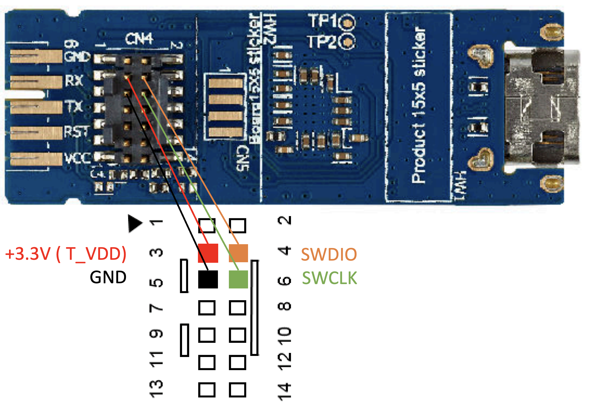
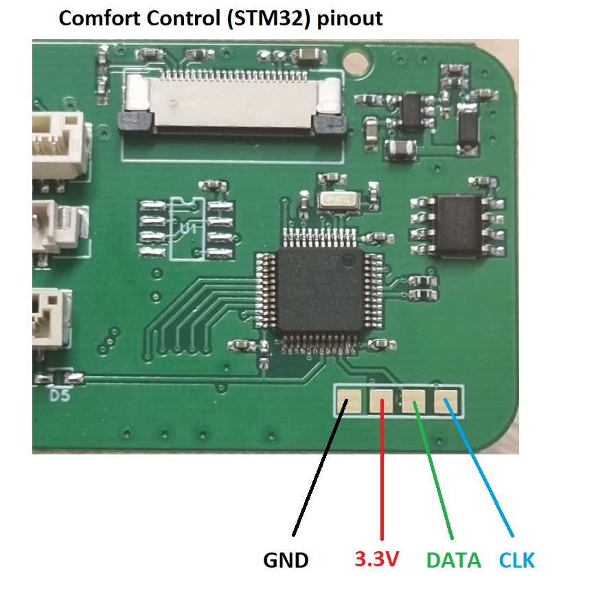
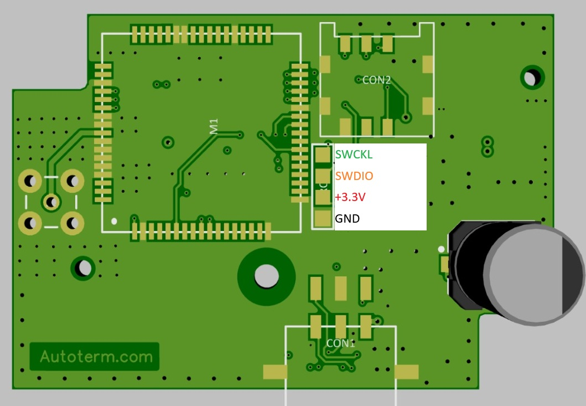
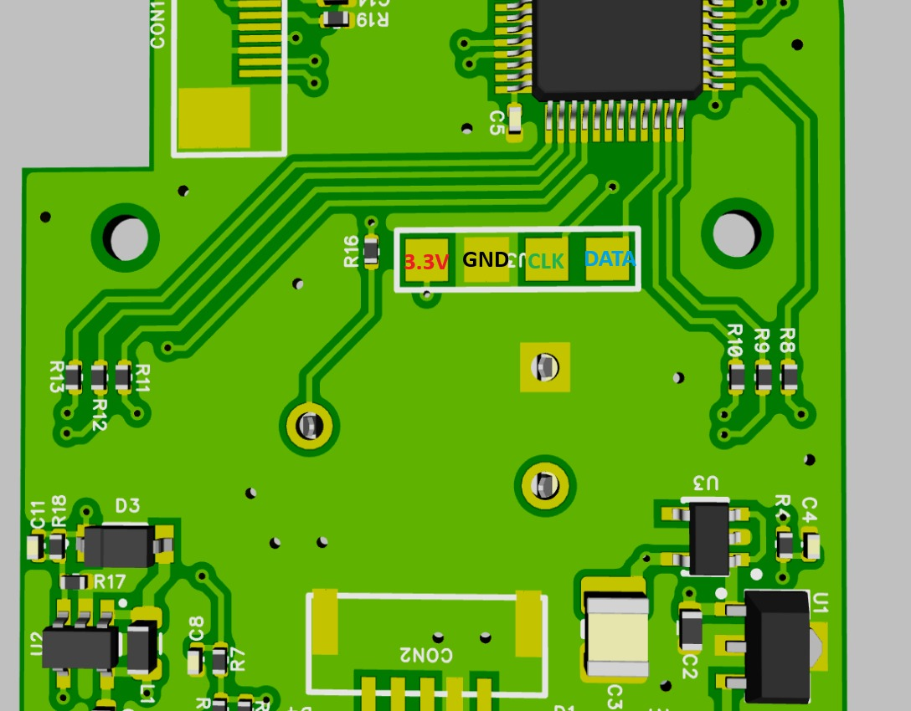
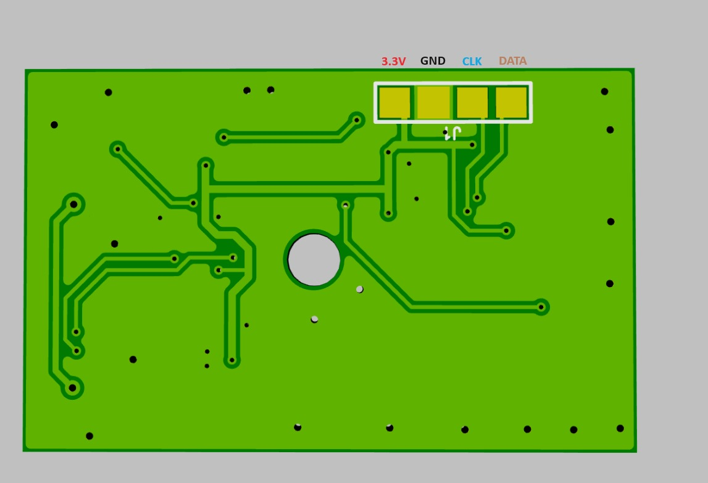
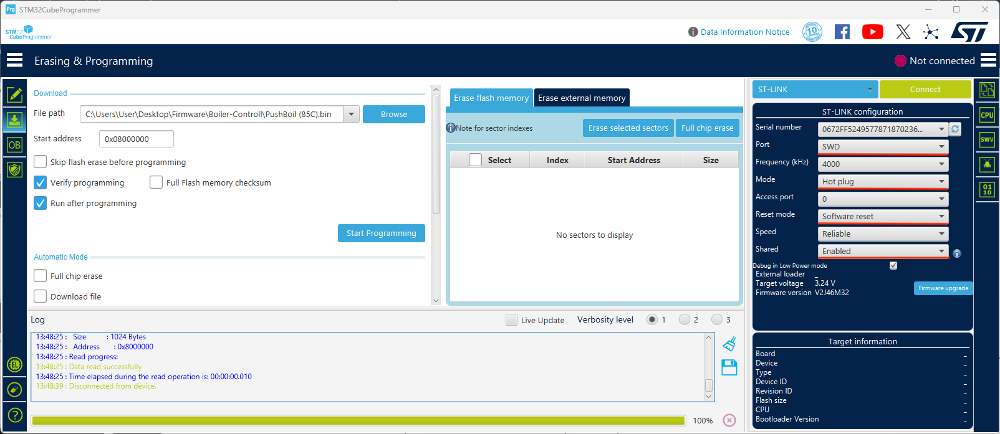
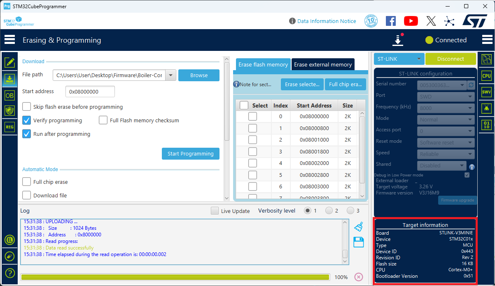
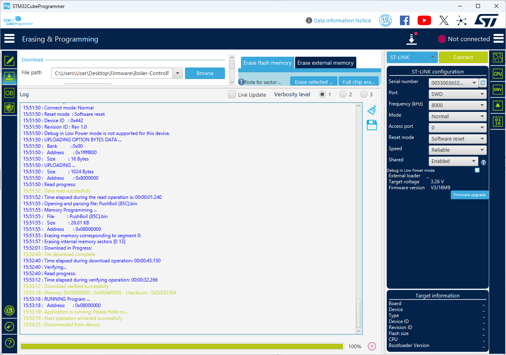

# Firmware

## How to programm microControler in heater

    
Air 2D

    
Air 4D

    
Air 9D

    
Flow 5

    
Flow 14

## How programm microControler in Control uint

1. 

    
 Which microControler is on PCB 

    | Control PCB          | MicroControler     |
    | ----------------------| :---------------:   |
    | Baltica               | STM32               |
    | Boiler                | STM32               |
    | Comfort               | STM32               |
    | GSM                   | STM32               |
    | Mini                  | STM32               |
    | Push                  | STM32               |
    | Travel Box            | STM32               |
    | CAN Gateway           | STM32               |

2. 

    
 Selecting programming tool & software 

    ### Programming software

    | MicroControler       | Programmator      | Link |
    | ----------------------| :---------------: | ---- |
    | STM32                 | ST-Link-V2        | https://www.st.com/en/development-tools/stsw-link004.html |
    | STM32                 | STLINK-V3MINIE    | https://www.st.com/en/development-tools/stm32cubeprog.html |
    | Microchip             | PICkit4           | ----      |
    | Raspberry             | ---               | ----      |

    ### ST-Link-V2 Pinout
    
    

    ### STLINK-V3MINIE

    

3. 

    
 Pinout for each PCB 

    +   

        
 Baltica Control Pinout 

        [Hex file with Baltica Heater code](./Baltica-Control/Heater/PushBoil%20(85C).bin)

        
        

    +   

        
 Boiler Control Pinout 

        [Hex file with Boiler Control code](./Boiler-Control/)

        
        

    +   

        
 Comfort Control Pinout 

        [Hex file with code](./Comfort-Control/STM32_CC_V1.27.bin)

        
        

    +   

        
 GSM-AT0060-Modem Pinout 

        [Hex file with GSM-AT0060-Modem code](./GSM-AT0060-Modem/Qstar_4G_V1.24.bin)

        
        

    +   

        
 Mini Control Pinout 

        [Hex file with Mini-Control code](./Mini-Control/MiniControl.bin)

        
        

    +   

        
 Push Control Pinout 

        [Hex file with Push-Control code](./Push-Control/PushControl_V1.00.bin)

        
        

    +   

        
 Travel-Box-Relay Pinout 

        [Hex file with Travel-Box code](./Travel-Box-Relay/Pow_switch_V1.1.bin)

        
        

    +   

        
 CAN Gateway Pinout 

        [Hex file with CAN Gateway code](./CAN-Gateway/UART-CAN-GATEWAY_V1.01.hex)

        
        
    

4. 

    
 How to write HEX / Bin file into microcontroler 

 
    +   

        
 STM32 ST-LINK utility ( Only for ST-Link/v2)

        
        4.1. Download & install STM32 ST-LINK utility

        4.2. Open programm and connect ST Link v2 to PC

        4.3. Select from drop down menu Target -> Settings

        4.4. Configure programmator settings:

        

        4.5. Connect programming pins from ST Link V2 to programming pads on PCB.  
        > **_NOTE:_**  Keep holding programming pins.

        4.6. Press OK in Settings menu

        4.7. If connection successful you shoul see device memory map, family, ID.

        

        4.8. Select HEX / Bin file by clicling on File -> Open file -> *select file* -> Open. In logs you can see file checksum - we will need it to verify programm instalation.

        

        4.9. Select from upper menu Target -> Program & Verify. Double check file path and press *Start*.

        

        4.10. If programming succeed - compare programmed memory checksum with HEX / Bin file checksum.

        

        4.11. Disconnect from microControler by selcting Target -> Disconnect.
        > **_NOTE:_**  Now you can remove programming pins.

        
 

    +   

        
 STM32CubeProgrammer 

        4.1. Download & install STM32CubeProgrammer.
        
        4.2. Open programm and connect ST-Link-V3-Minie to PC.
        
        4.3. Ensure that PC can read serial number and target voltage.

        

        > **_NOTE:_**  Target voltage should be around +3.3V.

        4.4. Click on second icon from left side menu to open programming tab and enter path to file.

        

        4.5. Setup programming settings and connect programming *pins* from ST-Link to programming *pads* on PCB. Press connect.

        

        > **_NOTE:_**  Keep holding programming pins.

        4.6. If connection was successful you should see information about MCU eg. Device name, Type, ID...

        

        4.7. Press *Start Programming*

        

        4.8 Press *Disconnect* and remove programming pins
    
   

5. 

    
 Potenial problems & how to fix them 

    Programmator can not connect to target
    - Check swDIO and swCLK pins
    - Check GND connection
    - Check if programmator can read Target voltage ( around +3.3V )
    - Select other option from ST-LINK conguration->Shared ( Enabled / Disabled ) 

    Programmator can not erase memory
    - Change mode to Normal 
    - Select lower frequency ( 5 - 200 ) kHz 

    