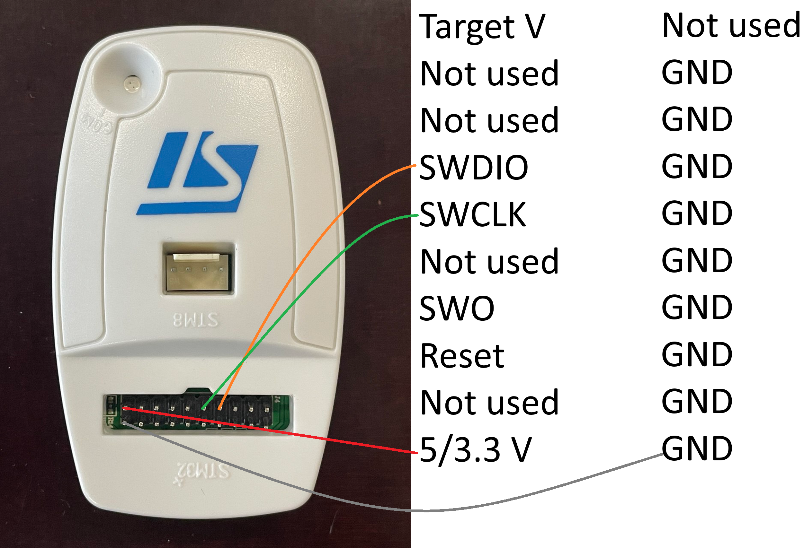
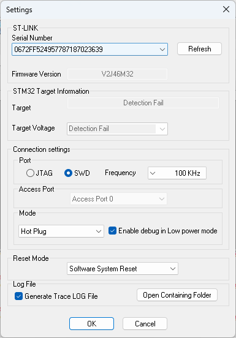
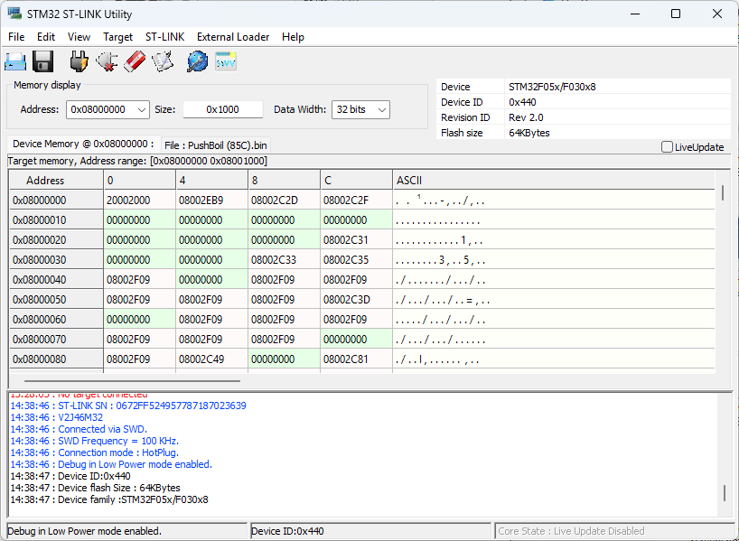
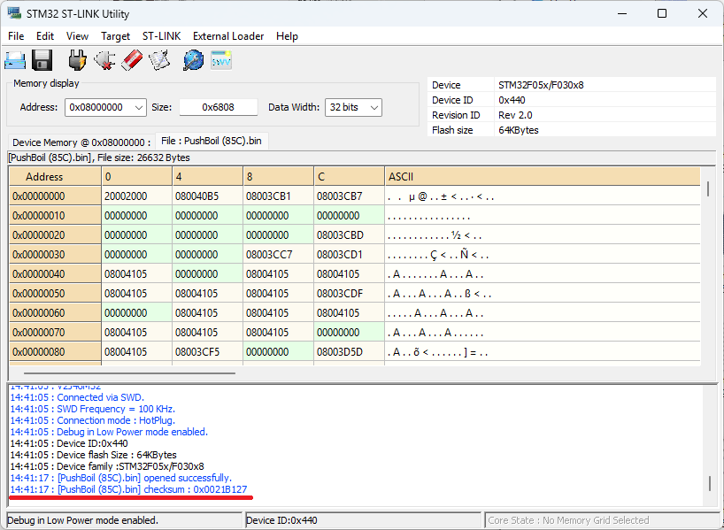
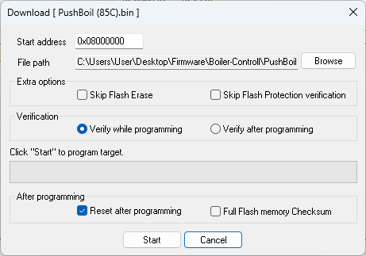
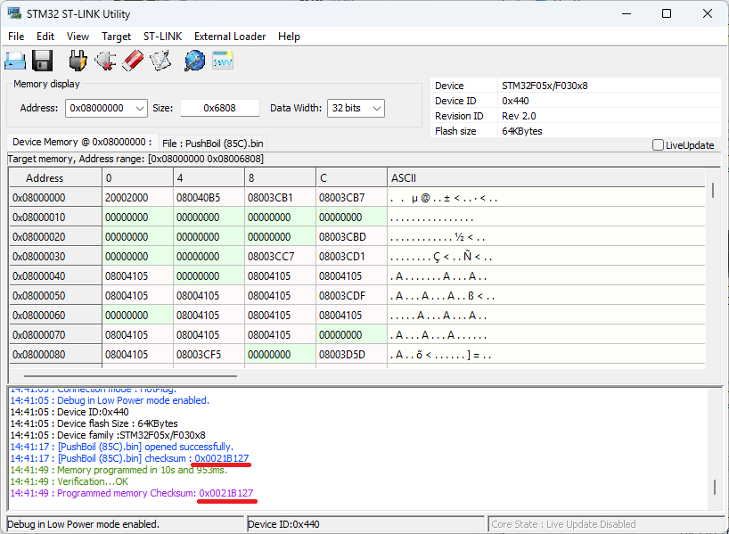
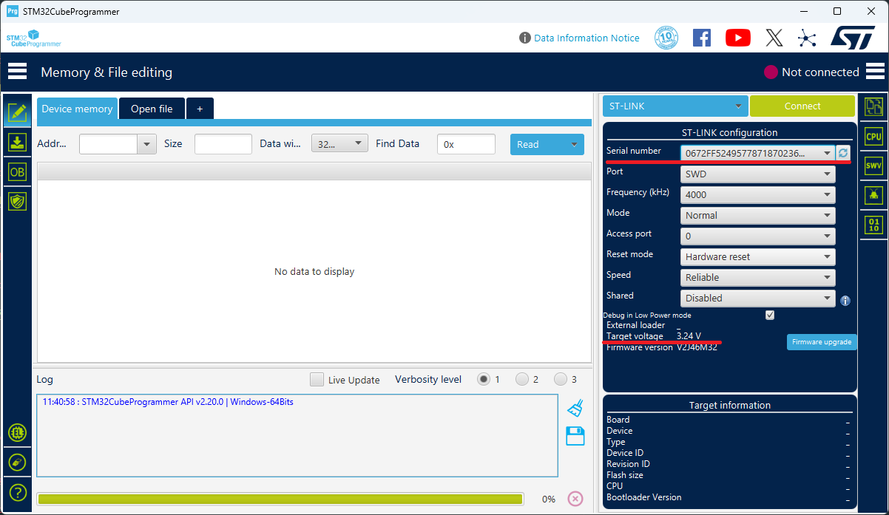
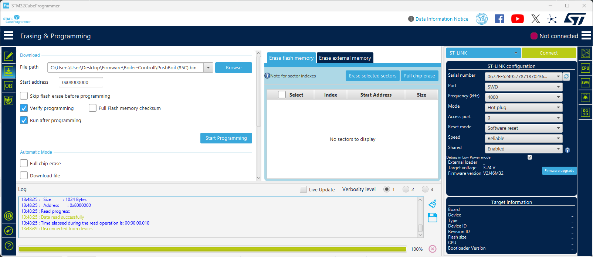

# Firmware

## How programm microcontroller

1. 

    
 What microcontroller are on PCB 

    | Controll PCB          | Microcontroller     |
    | ----------------------| :---------------:   |
    | Baltica               | STM32               |
    | Boiler                | STM32               |
    | Comfort               | STM32               |
    | GSM                   | STM32               |
    | Mini                  | STM32               |
    | Push                  | STM32               |
    | Travel Box            | STM32               |

2. 

    
 Selecting programming tool & software 

    ### Programming software

    | Microcontroller       | Programmator      | Link |
    | ----------------------| :---------------: | ---- |
    | STM32                 | ST-Link-V2        | https://www.st.com/en/development-tools/stsw-link004.html |
    | Microchip             | PICkit4           | ----      |
    | Raspberry             | ---               | ----      |

    ### ST-Link-V2 Pinout
    
    

3. 

    
 Pinout for each PCB 

    +   

        
 Baltica Controll Pinout 

        [Hex file with Baltica Heater code](./Baltica-Controll/Heater/PushBoil%20(85C).bin)

        
        

    +   

        
 Boiler Controll Pinout 

        [Hex file with Boiler Controll code](./Boiler-Controll/)

        
        

    +   

        
 Comfort Controll Pinout 

        [Hex file with code](./Comfort-Controll/STM32_CC_V1.27.bin)

        
        

    +   

        
 GSM-AT0060-Modem Pinout 

        [Hex file with GSM-AT0060-Modem code](./GSM-AT0060-Modem/Qstar_4G_V1.24.bin)

        
        

    +   

        
 Mini Controll Pinout 

        [Hex file with Mini-Controll code](./Mini-Controll/MiniControl.bin)

        
        

    +   

        
 Push Controll Pinout 

        [Hex file with Push-Controll code](./Push-Controll/PushControl_V1.00.bin)

        
        

    +   

        
 Travel-Box-Relay Pinout 

        [Hex file with Travel-Box code](./Travel-Box-Relay/Pow_switch_V1.1.bin)

        
        

    

4. 

    
 How to write HEX / Bin file into microcontroler 

 
    +   

        
 STM32 ST-LINK utility 

        1. Download & install STM32 ST-LINK utility

        2. Open programm and connect ST Link v2 to PC

        3. Select from drop down menu Target -> Settings

        4. Configure programmator settings:

        

        5. Connect programming pins from ST Link V2 to programming pads on PCB. 
        > **_NOTE:_**  Keep holding programming pins.

        6. Press OK in Settings menu

        7. If connection successful you shoul see device memory map, family, ID.

        

        8. Select HEX / Bin file by clicling on File -> Open file -> *select file* -> Open. In logs you can see file checksum - we will need it to verify programm instalation.

        

        9. Select from upper menu Target -> Program & Verify. Double check file path and press *Start*.

        

        10. If programming succeed - compare programmed memory checksum with HEX / Bin file checksum.

        

        11. Disconnect from microcontroller by selcting Target -> Disconnect.
        > **_NOTE:_**  Now you can remove programming pins.

        
 

    +   

        
 STM32CubeProgrammer 

        1. Download & install STM32CubeProgrammer
    
        2. Open programm and connect ST Link v2 to PC

        3. Ensure that PC can read serial number and target voltage

        

        > **_NOTE:_**  Target voltage should be around +3.3V.

        4. Setup programming settings and connect to microcontroller

        

    
   

    